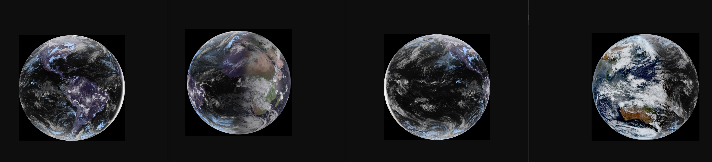

# MMM-Globe

A module for [MagicMirror²](https://github.com/MagicMirrorOrg/MagicMirror) that displays live satellite imagery of our planet as a beautiful globe on your mirror.

> Fork of [LukeSkywalker92/MMM-Globe](https://github.com/LukeSkywalker92/MMM-Globe), originally created by [Luke Scheffler](https://github.com/LukeSkywalker92), who had the idea of putting a live satellite globe on the mirror in the first place. Thank you, Luke!

**Coming from v3?** v4 is a rewrite with a new, simpler configuration — the module recognises your old one and helps you over. See [Upgrading from v3](#upgrading-from-v3).

This file is ordered by what you are here for:

- **Setting it up** — [Installation](#installation), [Update](#update), [Configuration](#configuration), [Available styles](#available-styles), [Upgrading from v3](#upgrading-from-v3)
- **Running it** — [How new images are found](#how-new-images-are-found), [Using EUMETSAT WMS](#using-eumetsat-wms), [Coastline underlay](#coastline-underlay), [Archive mode](#archive-mode), [Reliability & error handling](#reliability--error-handling)
- **How it works inside** — [Architecture](#architecture), [Technical notes](#technical-notes)

The version history lives in [CHANGELOG.md](CHANGELOG.md).

## Preview


**Four SLIDER perspectives** — GeoColor imagery from four geostationary satellites, each with day/night visualization and city lights:



*From left to right: GOES-19 (`americas`), Meteosat (`europe`), GOES-18 (`pacific`), Himawari (`asia`)*

## Background: Why this fork, and why v4?

The original MMM-Globe module has been unmaintained since 2021 but worked perfectly fine for years — until EUMETSAT discontinued their static image server at `eumetview.eumetsat.int`. This broke the European satellite styles that many European MagicMirror users relied on. The URLs came back for a while and are gone again.

EUMETSAT migrated to a new dynamic platform at `view.eumetsat.int`, but this is a JavaScript web application — there are no static image URLs to point the module at. EUMETSAT does however offer a **WMS (Web Map Service)** endpoint that can deliver satellite images in geostationary projection — perfect for globe display (see [Using EUMETSAT WMS](#using-eumetsat-wms)).

Additionally, the **CIRA SLIDER** service operated by [NOAA/RAMMB](https://rammb2.cira.colostate.edu/) at Colorado State University provides full-disk imagery of four geostationary satellites as PNG tiles, including the excellent **GeoColor** product — natural color during the day and city lights on a Blue Marble background at night. This makes for a particularly stunning globe display around sunrise and sunset.

The v3 releases added both sources, a coastline overlay, image saving, an archive for stale feeds and a sync to the publication grid. Along the way the module collected a lot of baggage: of its eleven styles only four were still alive (the Himawari-8 feeds are frozen since 2021, the GOES-16 path is broken, the EUMETSAT images discontinued), the options for timing kept growing, and drawing one little dot on an archive image needed Python and Pillow. **v4 is a rewrite** around what a globe on a mirror actually needs: show the latest image as soon as it is published, and keep looking good when the source has a bad day — with four live styles, your own image URL, no timing knobs, and no Python.

---

## Installation

Navigate into your MagicMirror's `modules` folder and execute:

```bash
cd ~/MagicMirror/modules
git clone https://github.com/rkorell/MMM-Globe.git
cd MMM-Globe
npm install
```

The module uses Node.js built-in modules plus **`suncalc`** for the [day phase of archive images](#how-the-archive-image-is-chosen), declared in its `package.json`.

## Update

To update the module to the latest version, navigate into the module folder and pull the latest changes:

```bash
cd ~/MagicMirror/modules/MMM-Globe
git pull
```

No `npm install` is needed — unless a release changed `package.json` or `package-lock.json`. v4.0.0 does. In that case the order is:

```bash
cd ~/MagicMirror/modules/MMM-Globe
rm -rf node_modules
git pull
npm install
```

## Configuration

Add the following to your `config.js`:

```js
{
    module: "MMM-Globe",
    position: "lower_third",
    config: {
        style: "europe",          // see Available styles below
        imageSize: 600
    }
},
```

For the Americas view with night city lights:

```js
config: {
    style: "americas",
    imageSize: 600
}
```

Full configuration with all options:

```js
{
    module: "MMM-Globe",
    position: "lower_third",
    config: {
        style: "europe",                   // europe, americas, pacific, asia — or "" for imageUrl
        imageUrl: "https://view.eumetsat.int/geoserver/wms?...",  // own image URL, used with style: ""
        updateInterval: 15 * 60 * 1000,    // poll interval of the own URL (15 min)
        imageSize: 600,                    // display size in pixels
        clipRadius: 48.55,                 // radius of the circular clip in percent; null = no clip
        coastlines: false,                 // coastline underlay for the own URL: europe, americas, pacific, asia
        switchToStaticIfStale: false,      // show archive images when the live feed goes stale
        staleFallbackMarker: "off",        // "off", "X:Y:Px:Color", or a text label
        lat: 52.52,                        // mirror location, for the day phase of archive images
        lon: 13.405,
        enableImageSaving: false,          // save every live image to images/
        logLevel: "info"                   // error, warn, info, debug
    }
},
```

### Options

| Option | Description |
|--------|-------------|
| `style` | Image style. See [Available styles](#available-styles) below. Set it to `""` to use `imageUrl` instead. An unknown value leaves the module empty and is logged.<br>**Type:** `string` **Default:** `"europe"` |
| `imageUrl` | URL of your own image source, used when `style` is `""`. Works with any image URL; the default is the EUMETSAT WMS (see [below](#using-eumetsat-wms)).<br>**Type:** `string` **Default:** EUMETSAT WMS, `msg_fes:rgb_naturalenhncd`, 600×600 |
| `updateInterval` | How often the own URL is fetched (in milliseconds). Not used for the SLIDER styles, which find their rhythm themselves (see [How new images are found](#how-new-images-are-found)). Values below 5 minutes are raised to 5 minutes; an unreadable value falls back to the default, both with a log line.<br>**Type:** `integer` **Default:** `15 * 60 * 1000` (15 minutes) |
| `imageSize` | Size of the displayed globe in pixels.<br>**Type:** `integer` **Default:** `600` |
| `clipRadius` | Radius of the circular clip in percent of the image size. 50 is the inscribed circle; a smaller value crops away an unwanted border or footer on **any** background. `null` turns the clip off.<br>**Type:** `number` (or `null`) **Default:** `48.55` |
| `coastlines` | Show a coastline and country border underlay beneath the satellite image. **Only applies to your own URL** — the SLIDER styles don't need it, and with a style set the module ignores it with a log line. See [Coastline underlay](#coastline-underlay).<br>**Values:** `false` (off), `"europe"`, `"americas"`, `"pacific"`, `"asia"` **Default:** `false` |
| `switchToStaticIfStale` | When `true`, the module switches to archive images from `static/` once the live feed stops delivering, and back when it recovers. Needs archive images of your own; see [Archive mode](#archive-mode).<br>**Type:** `boolean` **Default:** `false` |
| `staleFallbackMarker` | Visual marker to indicate archive mode. See [Fallback marker](#fallback-marker) for the three formats.<br>**Type:** `string` **Default:** `"off"` |
| `lat` | Mirror location latitude. Used to match archive images to the current day phase.<br>**Type:** `number` **Default:** `52.52` (Berlin) |
| `lon` | Mirror location longitude. Same purpose as `lat`.<br>**Type:** `number` **Default:** `13.405` (Berlin) |
| `enableImageSaving` | Save each new live image to the `images/` subfolder, named by its UTC time as `YYYYMMDD-HHMM` — the same naming the archive uses. For the SLIDER styles the name is the capture time, for your own URL the time of the fetch. Existing names are skipped.<br>**Type:** `boolean` **Default:** `false` |
| `logLevel` | Controls logging verbosity in the MagicMirror log. `"error"`: only errors. `"warn"`: adds warnings (e.g. failed fetches, archive mode). `"info"`: adds new images and the start line. `"debug"`: adds every poll and retry. Case doesn't matter.<br>**Values:** `"error"`, `"warn"`, `"info"`, `"debug"` **Default:** `"info"` |

### Available styles

All four styles use the [CIRA SLIDER](https://slider.cira.colostate.edu) API and show **GeoColor**: natural color by day, city lights on a Blue Marble background at night. They only download when a new image is available. The cadence is the one measured in the service's own list of captures, where it dominates clearly; the remainder are single missing slots.

| Style | Satellite | Region | Cadence |
|-------|-----------|--------|---------|
| `europe` | Meteosat (0°) | Europe / Africa | 15 min |
| `americas` | GOES-19 (75.2°W) | North / South America | 10 min |
| `pacific` | GOES-18 (137.0°W) | Pacific / West Americas | 10 min |
| `asia` | Himawari (140.7°E) | Asia / Australia | 10 min |

---

## How new images are found

A satellite publishes on a fixed cadence, but the module has no way of knowing *where* in that cadence it currently is. Poll every minute and you are never more than a minute behind, at the price of 1440 requests a day for 96 images. Poll once per cadence and you make 96 requests — but if the phase happens to sit badly, every image reaches the mirror almost a full cadence late.

So the module finds the phase instead of guessing it. For `style: "europe"` it looks like this:

| Time | What happens |
|------|--------------|
| 10:07 | Start. The list of captures is fetched, the newest image is shown. Its age is unknown, so it says nothing about the rhythm. |
| 10:08 – 10:12 | The list is fetched once a minute, nothing has changed. |
| 10:13 | The newest entry is a different one: the first observed publication. The image is fetched, and this moment becomes the anchor. |
| 10:29, 10:44, 10:59 … | One list request per cadence, a minute after the expected publication — and one image when there is a new one. |

A new image thus reaches the mirror at most two minutes after its publication, at one request per image.

If a publication is missing — that happens, always as a single slot — the module notes a gap and the next image comes on time; a missing image is never delivered afterwards, so there is nothing to chase. After a longer outage, when [archive mode](#archive-mode) has kicked in, the source may come back on a different schedule, so the module finds the phase again.

Your own URL works differently: the module knows nothing about it and doesn't try to. It fetches the image every `updateInterval`, counted from the start, and detects by a checksum whether it changed. A new image therefore appears up to one interval after its publication.

## Using EUMETSAT WMS

EUMETSAT's WMS endpoint at `view.eumetsat.int` can deliver satellite images in geostationary projection, which displays as a perfect globe with the module's circular clip. Combined with the `coastlines: "europe"` underlay, this effectively recreates the discontinued EUMETSAT imagery, which had the same kind of coastline overlay baked in. It is the default `imageUrl`, so this is all it takes:

```js
config: {
    style: "",                         // use imageUrl
    imageSize: 600,
    coastlines: "europe"
}
```

The default URL, should you want to adapt it:

```
https://view.eumetsat.int/geoserver/wms?service=WMS&version=1.3.0&request=GetMap&layers=msg_fes:rgb_naturalenhncd&bbox=-6500000,-6500000,6500000,6500000&width=600&height=600&CRS=AUTO:42003,9001,0,0&styles=&format=image/png&BGCOLOR=0x000000
```

The key parameter is `CRS=AUTO:42003,9001,{longitude},0` — this geostationary projection centered on the satellite's longitude produces a round Earth disc. `BGCOLOR=0x000000` gives a black background.

**Footer bar:** Some EUMETSAT WMS layers and sizes carry a footer bar (logo + timestamp) at the bottom. The default `clipRadius: 48.55` crops it away, and that works on any mirror background, not just black. Thanks to [@Muffexx](https://github.com/Muffexx) for the idea ([#1](https://github.com/rkorell/MMM-Globe/issues/1)).

Some useful WMS layers:

| Layer | Description |
|-------|-------------|
| `msg_fes:rgb_naturalenhncd` | Natural enhanced color (day side only, best colors) |
| `mtg_fd:rgb_geocolour` | MTG GeoColour (full disk, brownish tint) |
| `mtg_fd:rgb_truecolour` | MTG True Colour (full disk) |

The `msg_fes` layers update every 15 minutes, `mtg_fd` layers every 10 minutes. Set `updateInterval` accordingly.

## Coastline underlay

The `coastlines` option adds a subtle underlay of coastlines and country borders beneath the satellite image. It applies to your own URL only; the SLIDER styles don't need it.

Four pre-rendered PNG overlays are included, each in the geostationary projection of one satellite view:

- `"europe"` — centered at 0° longitude (Meteosat perspective)
- `"americas"` — centered at -75.2° longitude (GOES perspective)
- `"pacific"` — for the GOES-18 perspective
- `"asia"` — centered at 140.7° longitude (Himawari perspective)

The underlay uses CSS `mix-blend-mode: lighten`, which means the coastlines are only visible where the satellite image is dark (night side or black background). On the bright day side, the satellite image dominates completely. This creates a natural effect where borders fade in as the Earth rotates into night.

The alignment is calibrated for the default WMS image (600×600) and scales with `imageSize`, so it fits at any size.

The coastline data comes from Natural Earth (`ne_10m_coastline` + `ne_boundary_lines_land`) via the EUMETSAT WMS background layers.

## Archive mode

Satellite services have bad days — EUMETSAT's processing once stood still for more than 30 hours. Without help, the mirror would show the same frozen image all that time. Archive mode shows pre-recorded images instead, matched to the current time of day, and switches back as soon as the live feed recovers — no manual intervention needed.

### Enabling it

```js
config: {
    style: "",
    switchToStaticIfStale: true,
    staleFallbackMarker: "330:75:4:cornflowerblue",
    lat: 52.52,
    lon: 13.405
}
```

### When it kicks in

When the source delivers nothing new for **six publications in a row** — 60 minutes at a 10-minute cadence, 90 minutes at 15 minutes. This works the same for the SLIDER styles and your own URL, and also when the source delivers nothing from the start. A failed fetch, an error page and an unchanged image all count as nothing new.

At start, the log tells you if archive mode is enabled but `static/` holds nothing the module can use.

### Preparing archive images

The `static/` subfolder holds the archive images, named by their UTC capture time: `YYYYMMDD-HHMM.jpg` (or `.png`, `.gif`) — the same naming `enableImageSaving` uses. So building an archive is easy:

1. Set `enableImageSaving: true` and let the module collect images in `images/` over a full day.
2. Copy the images you want to `static/`. One every 15 minutes is plenty; any subset works.

In archive mode the module lays no coastline underlay beneath the image. If you want coastlines in the archive, the images need them drawn in.

### How the archive image is chosen

Archive images are captured on a specific date. As the seasons change, sunrise and sunset shift — the same UTC time may show a sunlit Europe in summer but a dark Europe in winter. The module therefore doesn't match the clock time but the **day phase**: it uses `suncalc` to work out where today's time lies between sunrise and sunset at your location (`lat`/`lon`), does the same for each archive image on its own date, and picks the closest. Sunrise meets sunrise, noon meets noon, night meets night — whatever the season of your archive.

Inside the polar circles, where the sun doesn't rise or set on some days, the module falls back to the UTC time of day.

### Fallback marker

An optional visual marker indicates that the module is showing archive images instead of live data. Three formats are supported.

**Dot marker** — a small colored dot at a specific pixel position on the archive image, drawn by the browser:

```js
// Subtle blue dot on Germany
staleFallbackMarker: "330:75:4:cornflowerblue"

// Larger red dot on Italy
staleFallbackMarker: "340:130:8:red"

// Format: "X:Y:Px:Color" — position, size, color
// Minimum: "X:Y" — uses defaults for size (4) and color (cornflowerblue)
```

Coordinates and size are in the pixel space of the archive image and scale with `imageSize`; a dot outside the circular clip is simply not visible.

**Text marker** — a small text label displayed below the globe:

```js
staleFallbackMarker: "Archive image"
```

Any value that is not `off` and does not match the `digits:digits[:digits[:text]]` pattern becomes a text label. Note the consequence: a label like `"12:30"` matches the dot pattern and is drawn as a dot at pixel 12,30 — outside the visible circle, so neither a dot nor a label appears.

**No marker:**

```js
staleFallbackMarker: "off"
```

Both marker types disappear automatically when the live feed recovers, and both come back right away after a browser reload.

## Reliability & error handling

Some upstream APIs (notably the EUMETSAT WMS GeoServer) occasionally respond with HTTP 200 but an XML error report instead of an image — typically during maintenance windows. The module checks every download against the signatures of PNG, JPEG and GIF before using it. Anything else — XML, HTML error pages, empty bodies — counts as a failed attempt, and the mirror keeps showing the last valid image. Note that other formats such as WebP or AVIF are rejected as well.

Every fetch has a timeout of 30 seconds and is attempted up to three times, ten seconds apart. If all attempts fail, a single warning names the cause (for example a DNS failure or a refused connection), and the module waits for the next regular poll. A failed image is a gap, not a reason to poll faster — your image collection keeps its regular rhythm.

The current image is written atomically, so the browser never reads half a file, and the old image stays on screen until the new one has fully loaded — no flicker on a change.

---

## Upgrading from v3

v4 recognises a configuration written for v3. Instead of the globe it then shows a notice, and it writes a complete v4 entry, derived from yours, to `new_globe_config.js` in the module folder. Your `config.js` is not changed.

1. Update as described under [Update](#update) — with `rm -rf node_modules` and `npm install`, because v4 brings a new dependency.
2. Restart MagicMirror. The notice appears.
3. Open `~/MagicMirror/modules/MMM-Globe/new_globe_config.js`, replace your MMM-Globe entry in `config.js` with the block in it, and check the lines marked `CHECK`. Every line says where its value came from. Your own comments from `config.js` are not in the file.
4. Restart MagicMirror. Once the new entry is valid, the module removes `new_globe_config.js`.

What changed:

| v3 | v4 |
|----|----|
| `geoColorEurope`, `meteosat` / `geoColorUSA` / `geoColorPacific` / `geoColorAsia` | `europe` / `americas` / `pacific` / `asia` |
| `geoColor`, `natColor`, `airMass`, `fullBand` (Himawari-8) | removed — frozen since 2021; `asia` shows the same region live |
| `centralAmericaDiscNat` (GOES-16) | removed — broken; `americas` shows the same region live |
| `europeDiscNat`, `europeDiscSnow` (EUMETSAT) | removed — discontinued; use `style: ""` with the default WMS |
| `ownImagePath` | `imageUrl` together with `style: ""` |
| `sliderPollInterval`, `syncDelay`, `retryDelay` | removed — the module finds the publication rhythm itself |
| `archiveSunPhase` | removed — the day phase comes from the date of each archive image |
| `clipRadius: null` = default of the style | `null` = no clip; default `48.55` |
| Default marker: dot; default `logLevel`: `"ERROR"` | `"off"`; `"info"` |
| Dot marker drawn with Python/Pillow | drawn by the browser, no Python needed |
| Retries paused while MMM-PresenceScreenControl reports the screen off | removed — retries take at most 20 seconds |

**Your archive:** v3 archive images are named by time only (`HHMM.jpg`); v4 needs the date as well (`YYYYMMDD-HHMM.jpg`) to match day and night, and does not use the old ones. Only you know when you took them, so the module can't rename them for you — rename them yourself with their capture date, or build a new archive with `enableImageSaving`. If your archive is enabled, both `new_globe_config.js` and the log tell you what they found. The v3 example `static/1200.jpg` stays in the repository, so that your own 12:00 image in its place does not block `git pull`.

To stay on v3: `git checkout v3.5.0` in the module folder.

---

## Architecture

The module uses a clean backend/frontend separation. The frontend knows nothing about remote URLs, polling, or image saving — it only displays what the backend provides.

**Backend (`node_helper.js`)** — all image fetching runs server-side, for consistent logging and to avoid CORS issues. One cycle serves every source: determine the state, fetch the image if it is new, show it, schedule the next run. For the SLIDER styles it finds and keeps the publication phase; for your own URL it polls at the fixed interval. It decides when archive mode applies and which archive image fits, and it keeps the last payload so that a browser reload shows the current image instantly.

**Sources (`sources.js`)** — everything the module knows about the SLIDER satellites: path, cadence, and how to build the URLs. A new satellite is one more entry, not one more branch in the code.

**Frontend (`MMM-Globe.js`)** — pure display. It builds its elements once and afterwards only swaps the image, so the old image stays until the new one has loaded. It clips the image to a circle with CSS `clip-path: circle()`, lays the optional coastline underlay beneath it with `mix-blend-mode: lighten`, and draws the fallback marker.

One MagicMirror limitation to be aware of: MagicMirror creates one `node_helper` per module *type*, not per instance. Two MMM-Globe entries in `config.js` therefore share one backend — the first one's configuration wins, and both show the same image.

## Technical notes

### CIRA SLIDER API

| Style | Satellite path | Coverage |
|-------|---------------|----------|
| `europe` | `meteosat-0deg` | Europe / Africa |
| `americas` | `goes-19` | Americas |
| `pacific` | `goes-18` | Pacific |
| `asia` | `himawari` | Asia / Australia |

The polling mechanism is identical for all satellites:

1. Query `https://slider.cira.colostate.edu/data/json/{sat}/full_disk/geocolor/latest_times.json` for available timestamps
2. Take the most recent timestamp (e.g., `20260227123000`, UTC)
3. Construct the tile URL: `https://slider.cira.colostate.edu/data/imagery/2026/02/27/{sat}---full_disk/geocolor/20260227123000/00/000_000.png`

Zoom level `00` returns the full disk as a single 464×464 PNG tile — perfect for the circular clip.

### EUMETSAT WMS

The geostationary projection `AUTO:42003,9001,{lon},0` maps the visible Earth disk as seen from a geostationary satellite at the given longitude. This produces a circular Earth image that works perfectly with the module's circular clip. See [Using EUMETSAT WMS](#using-eumetsat-wms) for a working URL and the available layers.

---

## Version history

See [CHANGELOG.md](CHANGELOG.md) for what changed in each release, the bugfixes carried over from the original module, and the housekeeping notes.

## Special Thanks

- **[Luke Scheffler](https://github.com/LukeSkywalker92)** ([@lukecodewalker](https://forum.magicmirror.builders/user/lukecodewalker) on the MagicMirror forum) for creating MMM-Globe. The idea of a live satellite globe on the mirror is what makes this module so appealing. This fork builds on his work.
- **[CIRA / RAMMB](https://rammb2.cira.colostate.edu/)** at Colorado State University for providing the SLIDER satellite imagery service, freely available to the public.
- **[EUMETSAT](https://www.eumetsat.int/)** for providing the WMS endpoint and Natural Earth background layers used for the coastline underlay.

## License

MIT — see [LICENSE](LICENSE).
