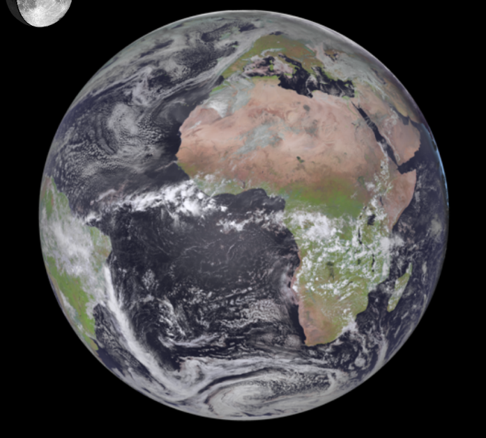

# MMM-Globe

A module for [MagicMirror²](https://github.com/MagicMirrorOrg/MagicMirror) that shows a current
satellite image of the Earth as a round disc. The source images are square; a circular
section of them is visible. When the image changes, the old one stays until the new one
has loaded.

> Fork of [LukeSkywalker92/MMM-Globe](https://github.com/LukeSkywalker92/MMM-Globe), originally
> created by [Luke Scheffler](https://github.com/LukeSkywalker92), whose idea it was to put a
> live satellite globe on the mirror. Thank you, Luke!

**Coming from v3?** v4 is a rewrite with a new, simpler configuration. See
[Upgrading from v3](#upgrading-from-v3). The version history is in [CHANGELOG.md](CHANGELOG.md).



The four styles, from the left: `americas`, `europe`, `pacific`, `asia`.


The module runs once per MagicMirror; a second instance would get the images of the first.

## Installation

```bash
cd ~/MagicMirror/modules
git clone https://github.com/rkorell/MMM-Globe.git
cd MMM-Globe
npm install
```

## Update

```bash
cd ~/MagicMirror/modules/MMM-Globe
git pull
```

Only if the commit changed `package.json` or `package-lock.json` — v4.0.0 does — use
instead:

```bash
cd ~/MagicMirror/modules/MMM-Globe
rm -rf node_modules
git pull
npm install
```

## Configuration

```js
{
    module: "MMM-Globe",
    position: "lower_third",
    config: {
        style: "europe",
        imageSize: 600
    }
},
```

| Option | Default | Meaning |
|---|---|---|
| `style` | `"europe"` | `europe`, `americas`, `pacific`, `asia`. Takes precedence over `imageUrl`. An unknown value leaves the module empty and is logged. |
| `imageUrl` | EUMETSAT WMS (see below) | Own image address. Applies when `style` is empty (`style: ""`). |
| `updateInterval` | `15 * 60 * 1000` | Poll interval of the own URL, in milliseconds. Minimum 5 minutes. No effect when `style` is set. |
| `imageSize` | `600` | Edge length of the globe in pixels. |
| `clipRadius` | `48.55` | Radius of the circular section in percent of the edge length. 50 % is the inscribed circle; smaller values cut off a border or footer. `null` turns the clipping off. |
| `coastlines` | `false` | Lay coastlines under the image: `europe`, `americas`, `pacific`, `asia`. Own URL only; with `style` set, the overlay stays off and the log says so. |
| `switchToStaticIfStale` | `false` | Allow archive mode. Needs archive images of your own, see [Archive mode](#archive-mode). |
| `staleFallbackMarker` | `"off"` | Marking of archive mode: `off` (in any case); `X:Y:Px:Colour` for a dot — X, Y and Px in pixels of the archive image from the top left, `Px` (default 4) and `Colour` (default `cornflowerblue`) may be omitted; any other text appears as a label below the globe. |
| `lat` / `lon` | `52.52` / `13.405` | Location. Determines which archive image matches the current sun phase. |
| `enableImageSaving` | `false` | Save every loaded live image under `images/`. |
| `logLevel` | `"info"` | `error`, `warn`, `info`, `debug`, in any case. |

Unreadable values for `updateInterval`, `coastlines` and `logLevel` are logged; the default
or no coastline applies instead.

## The four styles

All four come from [CIRA SLIDER](https://slider.cira.colostate.edu) and show `geocolor`:
true colour by day, at night city lights over an Earth image on which the land masses are
visible.

| Style | Satellite | Cadence |
|---|---|---|
| `europe` | Meteosat | 15 min |
| `americas` | GOES-19 | 10 min |
| `pacific` | GOES-18 | 10 min |
| `asia` | Himawari | 10 min |

With a style, the module first asks for the list of available captures and loads the image
only for a newer one. It determines the publication rhythm itself after the start and then
polls once per cadence, one minute after the expected change. A new image thus appears at
most two minutes after its publication.

## Own image source

Set `style: ""` and give `imageUrl`. The module fetches the address at the fixed interval
`updateInterval`, counted from the start, and detects by a checksum whether the image has
changed. A new image therefore appears up to one interval after its publication. The
default supplied is the EUMETSAT WMS:

```
https://view.eumetsat.int/geoserver/wms?service=WMS&version=1.3.0&request=GetMap
&layers=msg_fes:rgb_naturalenhncd&bbox=-6500000,-6500000,6500000,6500000
&width=600&height=600&CRS=AUTO:42003,9001,0,0&styles=&format=image/png&BGCOLOR=0x000000
```

These images have no coastlines and are black at night — that is what `coastlines` is for.
The lines lie under the image and are only visible where it is dark. Their position is
calibrated to this WMS section and adapts to `imageSize`.

## Fetch errors

A fetch is attempted up to three times, ten seconds apart; a response without image data
counts as an error. If an image fails, the previous one stays and the gap remains — the
next image comes on time.

## Archive mode

With `switchToStaticIfStale: true`: if the source delivers nothing new for six publications
in a row — 60 minutes at a 10-minute cadence, 90 minutes at a 15-minute cadence — the
module shows images from `static/`. This also applies if the source delivers nothing from the start. As soon as a
new image arrives, it returns to the live image by itself. If `static/` holds no usable
archive image, the log says so once at start, and the last live image stays; images in the
v3 naming `HHMM.jpg` are named in that message.

The archive image chosen is the one whose day phase at the own location is closest to the
current one — sunrise to sunrise, even with archive images from another season. If there
is no sunrise or sunset at the location, the UTC time of day counts.

The files are named `YYYYMMDD-HHMM.jpg`, `.png` or `.gif`, the time is UTC. The archive
images should come from the same source as the live image. In archive mode the module
lays no coastlines under the image; to see them in the archive, the images need the lines
drawn in. Everyone builds an archive themselves: collect with `enableImageSaving` and copy
the images wanted from `images/` to `static/`. The naming is the same in both directories.

## Saving images

`enableImageSaving: true` saves every loaded live image under `images/`. With a style the
file carries the capture time from the list of captures, with an own URL the time of the
fetch. Existing names are skipped. The directory is excluded from the repository.

## Upgrading from v3

v4 recognises a configuration written for v3. Instead of the globe it then shows a notice,
and it writes a complete v4 entry, derived from yours, to `new_globe_config.js` in the
module folder. Your `config.js` is not changed.

1. Update as described under [Update](#update) — with `rm -rf node_modules` and
   `npm install`, because v4 brings a new dependency.
2. Restart MagicMirror. The notice appears.
3. Open `~/MagicMirror/modules/MMM-Globe/new_globe_config.js`, replace your MMM-Globe entry
   in `config.js` with the block in it, and check the lines marked `CHECK`. Your own
   comments from `config.js` are not in the file.
4. Restart MagicMirror. Once the new entry is valid, the module removes
   `new_globe_config.js`; what changed stays listed below.

What changed:

| v3 | v4 |
|---|---|
| `geoColorEurope`, `meteosat` / `geoColorUSA` / `geoColorPacific` / `geoColorAsia` | `europe` / `americas` / `pacific` / `asia` |
| `geoColor`, `natColor`, `airMass`, `fullBand`, `centralAmericaDiscNat`, `europeDiscNat`, `europeDiscSnow` | removed — their sources are frozen, broken or discontinued |
| `ownImagePath` | `imageUrl` together with `style: ""` |
| `sliderPollInterval`, `syncDelay`, `retryDelay`, `archiveSunPhase` | removed — the module determines the rhythm and the sun phase itself |
| `clipRadius: null` = default of the style | `null` = no clipping; default `48.55` |
| Defaults: dot marker, `logLevel: "ERROR"` | `"off"`, `"info"` |
| Archive images named by time, `static/1200.jpg` | named by UTC date and time, `static/20260306-1200.jpg`; v4 uses the date to match day and night and does not use v3 images. Rename them yourself, each with the date it was taken, or build a new archive with `enableImageSaving`. The v3 example `static/1200.jpg` stays in the repository, so that an own 12:00 image in its place does not block `git pull`. |
| Dot marker drawn with Python/Pillow | drawn by the browser, no Python needed |
| Retries paused while MMM-PresenceScreenControl reports the screen off | removed — retries take at most 20 seconds |

To stay on v3: `git checkout v3.5.0` in the module folder.

## Special thanks

- **[Luke Scheffler](https://github.com/LukeSkywalker92)** for creating MMM-Globe and the idea
  behind it.
- **[CIRA / RAMMB](https://rammb2.cira.colostate.edu/)** at Colorado State University for the
  SLIDER satellite imagery, freely available to the public.
- **[EUMETSAT](https://www.eumetsat.int/)** for the WMS endpoint.

## License

MIT — see [LICENSE](LICENSE).
